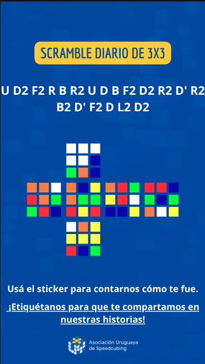

# Plan — Scramble del día

Plan de implementación de la feature **"scramble del día"** para la web de la AUS.

## Objetivo

Cada día, la web muestra un scramble oficial de 3x3 con la visualización del cubo,
y se genera una imagen vertical lista para subir a Instagram. La comunidad resuelve
ese scramble y —a futuro— sube sus tiempos desde la propia web.

## Documentos

| # | Documento | Tema |
|---|---|---|
| 00 | [Visión general](00-overview.md) | Objetivo, arquitectura, decisiones clave |
| 01 | [Motor de scramble](01-scramble-engine.md) | Generar el scramble diario y el estado del cubo |
| 02 | [Visualización del cubo](02-visualization.md) | Componente del cross-net (web + imagen) |
| 03 | [Imagen de Instagram](03-instagram-image.md) | Generación de la imagen vertical |
| 04 | [Sección en la web](04-web-section.md) | Integrar el scramble en la página |
| 05 | [Subida de resultados](05-results-upload.md) | Fase futura: cargar tiempos |

## Estado

| Etapa | Estado |
|---|---|
| Reestructura a monorepo | ✅ hecho |
| Esqueleto `@aus/scramble` | ✅ hecho |
| 01 · Motor de scramble | ✅ hecho |
| 02 · Visualización | ✅ hecho |
| 03 · Imagen de Instagram | ✅ hecho |
| 04 · Sección en la web | ⬜ pendiente |
| 05 · Subida de resultados | ⬜ futuro |

## Alcance de la primera entrega

Solo lo necesario para **publicar manualmente** en Instagram y mostrar el scramble
en la web. La subida de resultados (etapa 05) queda para después.
